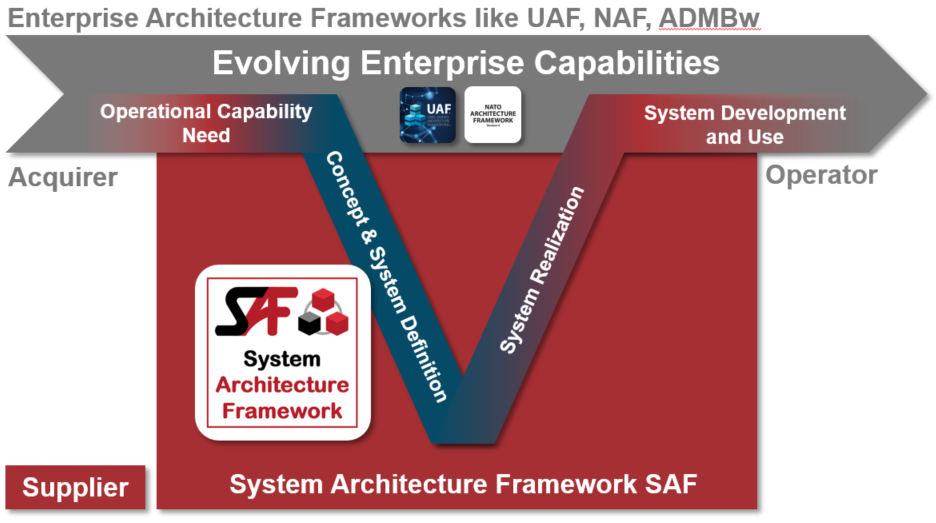


{: .note}
> **This site is a fork** of the official [SAF specification](https://github.com/{{ site.canonical_repository }}), built from the [{{ site.fork_repository }}](https://github.com/{{ site.fork_repository }}) repository. The owner of the repository is responsible for the content of this fork. The official, up-to-date specification lives at [{{ site.url }}]({{ site.url }}).


# Introduction
Inspired by the various enterprise architecture frameworks the System Architecture Framework (SAF) is a common, domain independent system architecture framework dedicated to support Model Based Systems Engineering (MBSE) of technical systems. 

The SAF can be used stand-alone and also complementary to enterprise architecture frameworks. SAF starts where an enterprise architecture framework stops.

# What is SAF? 
* SAF is SysML based architecture framework intended to support the Model Based Systems Engineering (MBSE) of technical systems.
* SAF is an open and extensible toolbox. It is developed by the SAF Working Group of the german INCOSE chapter [GfSE](https://gfse.org).
* SAF is based on a Systems Engineering Ontology and structured by viewpoint definitions.
* SAF supports 3 major [MBSE Tools](#tool-implementations). 

# SAF Grid
The following table shows the organisation of the SAF in [Domains](./userdoc/faq.md#domains) and [Aspects](./userdoc/faq.md#aspects). The cells of the grid contain the [Viewpoints](./userdoc/faq.md#viewpoints), please click on the links in the table to navigate to detailled descriptions of Domains, Aspects and Viewpoints.



# SAF Documentation

This site contains both documentation for users of SAF and developers of SAF. To understand how to use SAF, head over to [Using SAF](./userdoc/using.md). To understand how we develop SAF, see [Development Documentation](./devdoc/devdoc.md). We always welcome contributions from our MBSE community to improve SAF, see [how to contribute](./userdoc/contributing.md).

# Example
The System Architecture Framework Specification application is demonstrated using the **Fire Forest Detection System (FFDS)** example, courtesy of Tim Weilkiens. The Fire Forest Detection System example is based on the publication **SYSMOD - The Systems Modeling Toolbox, 3rd edition Pragmatic MBSE with SysML, Tim Weilkiens**

# Releases
This documentation is for the TdSE2026 release branch of SAF. See the change report for an information about major changes.
If you like to see the current state of development of SAF, please head over to the main branch which is updated as the development of SAF proceeds.


The released versions of SAF are available on the official documentation site at [{{ site.url }}]({{ site.url }}).



The following SAF releases are available, each of which is managed in a separate branch:
* [{{ release.label }}{{ release.id }}]({{ release.url }}{{ site.url }}/version/{{ release.id }})




# Tool Implementations
The SAF specification is implemented by 3 tool specific profiles which are available in separate github repositories:

* [Cameo Systems Modeler (by Dassault Systèmes)](https://github.com/GfSE/SAF-Cameo-Profile/tree/TdSE2026)
* [Engineering Systems Design Rhapsody (by IBM)](https://github.com/GfSE/SAF-Rhapsody-Profile/tree/TdSE2026)
* [Enterprise Architect (by Sparx Systems)](https://github.com/GfSE/SAF-EA-Profile/tree/TdSE2026)

# References
* Modellbasierter Bärentango mit dem System Architecture Framework, TdSE 2021, Michael Leute, Alexander Haarer, Sascha Ackva, Christian Lalitsch-Schneider, Markus Andres, Stephan Husung und Piotr Malecki
* System Architecture Framework (SAF), EMEASEC 2018, Rodrigo Batista, Alexander Haarer, Sascha Ackva, Christian Lalitsch-Schneider
* System Safety in SysML, TdSE 2015, T. Weilkiens, A. Berres, D. Endler, A. Haarer, C. Lalitsch-Schneider, M. Krammer, H. Martin
